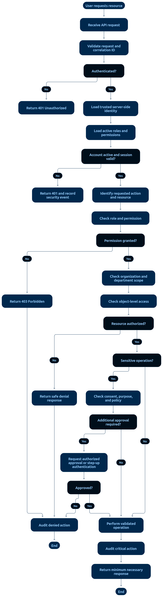

# 01 — Roles and Permissions

> **Document:** Role definitions, permission matrix, and granular permission catalog for the HMS
> **Version:** 1.0
> **Status:** Draft for review
> **Audience:** Developers and AI coding agents
> **Related documents:** `02-AUTHENTICATION-AND-AUTHORIZATION-FLOW.md`, `03-SCOPE-AND-ASSUMPTIONS.md §7`, `02-PROJECT-GLOSSARY.md`
> **Rule:** Permissions are enforced **server-side only**. The frontend uses permissions purely to show/hide UI; it is never a source of truth.

---

## 1. How to Read This Document

- **Permission levels** used in the matrix are defined in `02-PROJECT-GLOSSARY.md §1`: `Manage`, `Authorized`, `Limited`, `Assigned`, `Own`, `No`.
- The **matrix** (Section 3) is the summary for humans.
- The **permission catalog** (Section 4) is the implementation source of truth: granular permissions (`PERM-xx`) mapped to roles. Code must check these, not role names.
- **Scope rules** (Section 5) further restrict access by patient assignment, department, and encounter.

---

## 2. Role Definitions

| Role | Definition | MFA |
|------|------------|-----|
| **Admin** | System administrator: users, roles, settings, audit review, backups. Does **not** gain automatic access to clinical content. | **Required** |
| **Receptionist** | Front desk: patient registration, appointment booking/rescheduling, check-in, queue, limited billing view. | Configurable |
| **Doctor** | Clinician: consultations, EMR, prescriptions, lab orders — only for patients within their assigned scope. | Configurable |
| **Nurse** | Nursing staff: nursing entries and assigned-patient views. | Configurable |
| **Lab Technician** | Lab staff: specimen tracking, result entry, verification, release. | Configurable |
| **Pharmacist** | Pharmacy staff: prescription validation, dispensing, medicine inventory. | Configurable |
| **Accountant** | Finance staff: invoices, payments, refunds, financial reports. | Configurable |
| **Patient** | Person receiving care: own appointments, own bills, own released results. | No (configurable) |

---

## 3. Role Permission Matrix (Summary)

| Feature / Resource | Admin | Receptionist | Doctor | Nurse | Lab Tech | Pharmacist | Accountant | Patient |
|---|---|---|---|---|---|---|---|---|
| Patient registration | Manage | Manage | Limited | Limited | No | No | No | Self-registration |
| Patient demographics | Authorized | Manage | Assigned | Assigned | Limited | Limited | Billing-only | Own |
| Appointments | Manage | Manage | Own schedule | Assigned view | No | No | No | Own |
| Clinical encounters | Authorized | No | Create/manage assigned | Nursing entries | Relevant orders | No | No | Read released |
| Nursing records | Authorized | No | Relevant view | Manage assigned | No | No | No | Permitted view |
| Lab orders/results | Authorized | Limited | Order/review | Assigned view | Process/verify | No | Billing-only | Released results |
| Prescriptions | Authorized | No | Create | Relevant view | No | Dispense | No | Own |
| Pharmacy inventory | Manage | No | No | No | No | Manage | No | No |
| Billing/invoices | Authorized | Limited | No | No | Limited | Limited | Manage | Own bills |
| Payments/refunds | Authorized | Limited | No | No | No | No | Manage | Own payment activity |
| Reports | Authorized | Operational | Own activity | Assigned activity | Lab scope | Pharmacy scope | Financial scope | Own data |
| User & role management | Manage | No | No | No | No | No | No | No |
| Audit logs | Authorized | No | Limited own events | No | No | No | Limited financial events | No |
| Break-glass access | Authorized + oversight | No | Approved use | Approved use | No | No | No | No |

---

## 4. Permission Catalog (Implementation Source of Truth)

Each permission is a string checked by backend middleware. Roles are granted sets of permissions; scope checks (Section 5) are applied on top.

### 4.1 Patient Management
| ID | Permission | Granted to |
|----|------------|-----------|
| PERM-01 | `patient.create` | admin, receptionist |
| PERM-02 | `patient.read.own` | patient |
| PERM-03 | `patient.read.assigned` | doctor, nurse |
| PERM-04 | `patient.read.all` | admin (demographics only, not clinical notes) |
| PERM-05 | `patient.update` | admin, receptionist |
| PERM-06 | `patient.update.own` | patient (non-identity fields) |
| PERM-07 | `patient.consent.manage` | admin, receptionist, patient(own) |

### 4.2 Appointments
| ID | Permission | Granted to |
|----|------------|-----------|
| PERM-10 | `appointment.create.any` | admin, receptionist |
| PERM-11 | `appointment.create.own` | patient |
| PERM-12 | `appointment.reschedule` | admin, receptionist; patient(own within policy) |
| PERM-13 | `appointment.cancel` | admin, receptionist; patient(own within policy) |
| PERM-14 | `appointment.checkin` | receptionist |
| PERM-15 | `appointment.queue.manage` | receptionist |
| PERM-16 | `appointment.read.own-schedule` | doctor |
| PERM-17 | `appointment.read.assigned` | nurse |

### 4.3 Clinical / EMR
| ID | Permission | Granted to |
|----|------------|-----------|
| PERM-20 | `encounter.create` | doctor |
| PERM-21 | `emr.write` | doctor |
| PERM-22 | `emr.amend` | doctor (own records; audited) |
| PERM-23 | `emr.read.assigned` | doctor, nurse (scoped) |
| PERM-24 | `nursing.entry.create` | nurse |
| PERM-25 | `emr.read.released.own` | patient |

### 4.4 Laboratory
| ID | Permission | Granted to |
|----|------------|-----------|
| PERM-30 | `lab.order.create` | doctor |
| PERM-31 | `lab.specimen.record` | lab_tech |
| PERM-32 | `lab.result.enter` | lab_tech |
| PERM-33 | `lab.result.verify` | lab_tech (or senior lab role) |
| PERM-34 | `lab.result.release` | lab_tech |
| PERM-35 | `lab.result.read.assigned` | doctor (own patients) |
| PERM-36 | `lab.result.read.released.own` | patient |

### 4.5 Pharmacy
| ID | Permission | Granted to |
|----|------------|-----------|
| PERM-40 | `prescription.create` | doctor |
| PERM-41 | `prescription.validate` | pharmacist |
| PERM-42 | `prescription.dispense` | pharmacist |
| PERM-43 | `pharmacy.inventory.manage` | pharmacist |
| PERM-44 | `pharmacy.stock.adjust` | pharmacist (audited), admin approval for large adjustments |
| PERM-45 | `prescription.read.own` | patient |

### 4.6 Billing & Finance
| ID | Permission | Granted to |
|----|------------|-----------|
| PERM-50 | `invoice.create` | accountant |
| PERM-51 | `invoice.read.any` | accountant, admin |
| PERM-52 | `invoice.read.own` | patient |
| PERM-53 | `payment.record` | accountant, receptionist (limited, per policy) |
| PERM-54 | `payment.refund.approve` | accountant, admin |
| PERM-55 | `invoice.amend` | accountant (audited) |

### 4.7 Administration, Audit & Security
| ID | Permission | Granted to |
|----|------------|-----------|
| PERM-60 | `user.manage` | admin |
| PERM-61 | `role.assign` | admin |
| PERM-62 | `settings.manage` | admin |
| PERM-63 | `audit.read.all` | admin |
| PERM-64 | `audit.read.own-events` | doctor |
| PERM-65 | `audit.read.financial` | accountant (financial events only) |
| PERM-66 | `breakglass.use` | approved doctor, nurse (per facility list) |
| PERM-67 | `breakglass.review` | admin |
| PERM-68 | `backup.manage` | admin |

---

## 5. Scope Rules (Applied on Top of Permissions)

A permission grants the *capability*; scope decides *which records* it applies to. Both must pass.

| Rule ID | Rule |
|---------|------|
| R-01 | A Doctor may access a patient's clinical data only if the patient is in their **assigned scope** (their appointment, encounter, or ward assignment). |
| R-02 | A Nurse may access only patients assigned to them for care. |
| R-03 | A Patient may access only their **own** records and only **released** clinical data. |
| R-04 | Receptionist billing access is limited to charges/payments captured at the desk, not financial reports. |
| R-05 | Lab Technicians see orders/specimens for the lab workflow; they do not browse full clinical notes. |
| R-06 | Admin access to patient data is limited to demographics and administration — never clinical notes — except via break-glass. |
| R-07 | Accountant access covers invoices/payments/refunds; never clinical content. |
| R-08 | Every access to a patient record beyond the user's own is audited. |
| R-09 | Guessing or enumerating record IDs must never succeed (object-level authorization on every request). |
| R-10 | Emergency (break-glass) access is the only path around scope limits, and it is reason-bound, time-limited, and audited (see `05-SECURITY-AND-PRIVACY/04-EMERGENCY-BREAK-GLASS-ACCESS.md`). |

---

## 6. Authorization Check Order

**Diagram analysis** — This vertical pipeline diagram is the visual form of the Universal Secure Request Pipeline (`05-SECURITY-AND-PRIVACY/01-SECURITY-REQUIREMENTS.md §1`):

- **Strictly ordered stages, no bypass edges:** request → authenticate → permission (RBAC) check → scope/assignment check → business rules → transaction → audit → response. There is deliberately no arrow that skips a stage.
- **Two distinct rejection points:** a *permission* denial (role lacks the PERM-xx) and a *scope* denial (record outside assignment, R-01…R-10) are drawn separately — implementation must keep them as separate middleware steps (`requirePermission` then `requireScope`), each audited when sensitive.
- **Business rules sit after authorization:** status transitions and policy windows are only evaluated for users who are already proven entitled — prevents policy errors from leaking access decisions.
- **The transaction node** groups all writes atomically before the audit node commits the trail — matching the outbox/transaction rules in `04-SYSTEM-DESIGN/02-DATABASE-DESIGN.md §6`.

For every protected request, the backend must check **in this order**:

1. **Authentication** — valid session/token?
2. **Permission check** — does the user's permission set include the required `PERM-xx`?
3. **Scope check** — does the target record fall within the user's assignment/scope rules?
4. **Object-level check** — does the specific record ID belong to the permitted set?
5. **Business rules** — status transitions, policy windows, facility configuration?
6. **Audit** — record the access/action if it touches sensitive data.

Only after all pass may the operation execute inside a transaction.

---

## 7. Matrix Change Control

- Changes to the matrix or catalog require Admin authorization, validation, and audit logging (NFR-41).
- The catalog in Section 4 must stay synchronized with `02-AUTHENTICATION-AND-AUTHORIZATION-FLOW.md` and the API middleware implementation. Any mismatch is a defect.

---

*End of document — Roles and Permissions v1.0*
