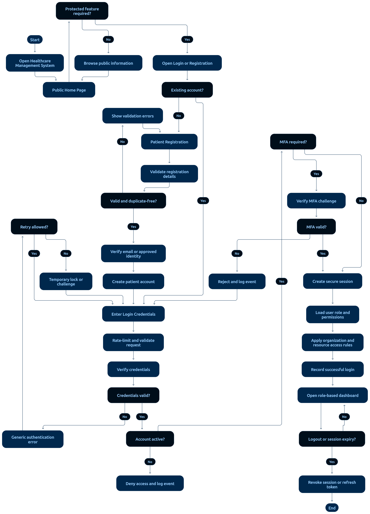

# 02 — Authentication and Authorization Flow

> **Document:** How users authenticate, how sessions work, and how every request is authorized in the HMS
> **Version:** 1.0
> **Status:** Draft for review
> **Audience:** Developers and AI coding agents
> **Related documents:** `01-ROLES-AND-PERMISSIONS.md`, `05-SECURITY-AND-PRIVACY/01-SECURITY-REQUIREMENTS.md`, `06-API-AND-ERRORS/01-API-DESIGN-STANDARDS.md`
> **Rule:** The frontend is never trusted. Identity and permissions are established server-side and re-verified on every request.

---

## 1. Authentication Flow (Login)



**Diagram analysis** — The flowchart shows the complete login journey and matches the reference flow below node-for-node:

- **Single entry, single gate:** every path converges on credential verification before any authorization decision — there is no branch that skips validation.
- **Decision diamonds** mark the two hard gates: *credentials valid?* and *MFA required/configured?* — mirroring FR-04, FR-07 and SEC-01/SEC-04.
- **Failure branches are terminal and generic:** wrong password, unknown account, locked account, and MFA failure all terminate at the same neutral error state (SEC-02 anti-enumeration) — the diagram deliberately does not distinguish them for the user, though each writes a distinct audit event.
- **Success path ends at the role dashboard**, loaded from server-side permissions — visually reinforcing that the dashboard shape is decided by the server (SEC-07), not the client.
- Implementation note for agents: the diagram's "load permissions" node maps to `/auth/me` (EP-03); the audit writes on both success and failure paths map to FR-54/AC-59.

Reference flow (text form):

```text
START
  │
  ▼
User submits credentials (email/username + password)
  │
  ▼
HTTPS request → rate-limit check (NFR-10)
  │  ├─ over limit → generic lockout message → END (audit failure)
  ▼
Look up account by identifier
  │  ├─ not found → run dummy hash comparison → SAME generic error → END (audit)
  ▼
Verify password against Argon2id hash (constant-time compare)
  │  ├─ mismatch → generic error, increment failure counter → END (audit failure)
  ▼
Account status check (ACTIVE required; LOCKED/SUSPENDED → generic error)
  │
  ▼
MFA required? (privileged roles per policy)
  │  ├─ yes, MFA not configured → force MFA enrollment → END
  │  ├─ yes, MFA configured → verify second factor
  │  │     └─ invalid → generic error → END (audit failure)
  ▼
Create session (secure cookie / token), load permissions from server
  │
  ▼
Write audit event: successful login (actor, time, IP, device)
  │
  ▼
Redirect to role-based dashboard → END
```

**Anti-enumeration rule (FR-06):** login failure and password-recovery responses are **identical** whether or not the account exists. No usernames are revealed.

---

## 2. Password Recovery Flow

```text
User submits email
  │
  ▼
Always show the same neutral message ("If the address is registered, a reset link has been sent")
  │
  ▼
If account exists: create single-use, time-limited reset token (e.g., 30 min)
  → send email → audit event
  │
  ▼
User sets new password → invalidate all existing sessions → audit event
```

Rules: reset tokens are single-use and expire; password history prevents reuse of recent passwords (configurable); all other sessions are invalidated after reset.

---

## 3. Patient Self-Registration Flow

```text
Visitor opens Register page
  │
  ▼
Submit demographics + contact + password
  │
  ▼
Server validation (format, strength, uniqueness, bot protection)
  │
  ▼
Create account with role = Patient (hard-coded; staff roles are NOT selectable)
  │
  ▼
Show privacy notice; store consent flags with timestamp
  │
  ▼
Verify email (configurable) → login allowed → redirect to Patient dashboard
```

---

## 4. Session Model

| Property | Rule |
|----------|------|
| Storage | HTTP-only, Secure, SameSite cookie (or server-side session); no tokens in localStorage |
| Idle timeout | 30 min default, configurable (NFR-11) |
| Absolute lifetime | 12 h default, configurable |
| Renewal | Sliding renewal on activity, never beyond absolute lifetime |
| Invalidation | On logout, password change, role change, or admin suspension |
| Contents | Session references the user ID on the server; **permissions are loaded from the database**, never from client data |

---

## 5. Authorization Flow (Every Protected Request)

```text
Request arrives (HTTPS)
  │
  ▼
1. AUTHENTICATION — resolve session/token → current user
  │     └─ invalid/expired → 401
  ▼
2. PERMISSION CHECK — required PERM-xx ∈ user's server-loaded permission set
  │     └─ missing → 403 (audit if sensitive resource)
  ▼
3. SCOPE CHECK — target record within user's assignment/scope (R-01…R-10)
  │     └─ outside scope → 403 (audit)
  ▼
4. OBJECT-LEVEL CHECK — specific record ID belongs to permitted set
  │     └─ not owned/permitted → 403 (audit — possible IDOR attempt)
  ▼
5. BUSINESS RULES — status transitions, policy windows, facility config
  │     └─ violation → 422 with rule identifier
  ▼
6. TRANSACTION — execute operation atomically
  │
  ▼
7. AUDIT + RESPONSE — record event if required; return minimum-necessary fields
```

This pipeline is mandatory for **every** protected API operation and mirrors the Universal Secure Request Pipeline in `05-SECURITY-AND-PRIVACY/01-SECURITY-REQUIREMENTS.md`.

---

## 6. Authorization Middleware Contract (Backend)

Each protected route declares exactly what it needs; middleware enforces it before the handler runs.

```text
requireAuth                       → steps 1
requirePermission(PERM-xx)        → step 2
requireScope('patient' | 'encounter' | 'lab' | 'pharmacy' | 'finance') → step 3
assertObjectOwnership(resourceId) → step 4
```

Example enforcement for "Doctor opens a lab result":

1. `requireAuth` → valid doctor session
2. `requirePermission('lab.result.read.assigned')` → PERM-35 present
3. `requireScope('patient')` → result's patient is assigned to this doctor
4. `assertObjectOwnership(resultId)` → the result belongs to that patient
5. Business rules → result status is `VERIFIED`/`RELEASED`
6. Transaction not needed (read) → audit access → return result

---

## 7. Logout & Account Lifecycle

| Event | Behavior |
|-------|----------|
| Logout | Invalidate session server-side; clear cookie; audit |
| Password change/reset | Invalidate all sessions; audit |
| Role/permission change | Invalidate sessions for re-authorization on next login; audit (NFR-41) |
| Account suspension/lock | Immediate session invalidation; block login; audit |
| Long inactivity (configurable) | Optional account dormancy policy; reactivation requires verification |

---

## 8. Security Invariants (Never Violate)

1. No client-supplied role, user ID, or permission is ever trusted.
2. Authorization is checked on **every** protected request — no "already verified earlier" shortcuts.
3. Authentication failures return generic messages and are audited (without passwords or secrets).
4. MFA enrollment is forced for privileged roles before dashboard access.
5. Self-registration can create only the `Patient` role.
6. Session cookies are HTTP-only, Secure, SameSite; never stored in localStorage.
7. All authentication and authorization events are written to the audit log.

---

*End of document — Authentication and Authorization Flow v1.0*
