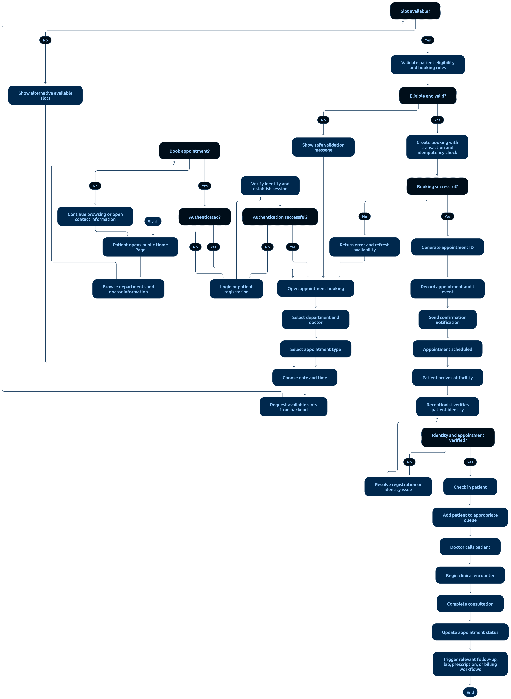

# 02 — Patient Appointment Workflow

> **Document:** Complete patient appointment workflow: booking, rescheduling, cancellation, check-in, and queue
> **Version:** 1.0
> **Status:** Draft for review
> **Audience:** All audiences
> **Related documents:** `03-APPOINTMENT-LIFECYCLE.md`, `01-ROLES-AND-PERMISSIONS.md`, `01-FUNCTIONAL-REQUIREMENTS.md §5`
> **Rule:** Slot availability is re-verified inside a transaction at commit time. Retries never create duplicates.

---

## 1. Complete Appointment Flow



**Diagram analysis** — This tall swimlane-style flowchart covers the full booking journey and aligns with the reference flow below:

- **Two actor entries merge early:** patient self-booking and reception booking converge on the same slot-selection and validation sequence — one code path serves both (EP-21 with `appointment.create.any`/`.own`).
- **The availability check appears twice by design:** once when slots are shown (UX filtering, EP-20) and again inside the booking transaction — the diagram makes the double-check explicit, which is the double-booking protection (NFR-05/AC-15).
- **Branch on slot-taken:** the flow routes to alternatives/waitlist rather than failing dead-end — matching the waitlist sub-flow (§5).
- **Post-booking chain:** confirmation notification → confirmation state → visit-day check-in with identity verification → queue token → consultation → completion, each node annotated with the responsible actor.
- Every status-changing node in the diagram corresponds to a transition in `03-APPOINTMENT-LIFECYCLE.md` (T-01…T-12).

Reference flow (text form):

```text
START
  │
  ▼
Actor: Patient (own) or Receptionist (any patient)
  │
  ▼
Choose department → doctor → date
  │
  ▼
System shows available slots (server-computed)
  │  └─ no slot open → offer Waitlist (S-17) → END
  ▼
Select slot → enter/confirm patient + reason for visit
  │
  ▼
VALIDATION
  ├── patient identity/record valid?
  ├── doctor working that day/shift?
  └── request idempotency key present?
  │
  ▼
TRANSACTION: re-check slot availability → create appointment (REQUESTED/SCHEDULED)
  │  ├─ slot taken concurrently → CONFLICT error, offer alternatives → END
  ▼
Notification: confirmation to patient (+ doctor schedule view)
  │
  ▼
CONFIRMED (per policy: auto or manual)
  │
  ▼
Visit day: Reception verifies identity → CHECKED_IN → queue token issued
  │
  ▼
IN_CONSULTATION (doctor starts encounter — see 07-CLINICAL-CONSULTATION-WORKFLOW.md)
  │
  ▼
COMPLETED (encounter finalized)
  │
  ▼
END → billing follows (see 04-BILLING-WORKFLOW.md)
```

---

## 2. Alternative Transitions

| From | To | Trigger | Rules |
|------|----|---------|-------|
| `REQUESTED` | `CANCELLED` | Patient/staff cancels before scheduling completes | Policy window applies |
| `SCHEDULED` | `RESCHEDULED` | Either party moves the appointment | New slot re-verified in transaction; audit both changes |
| `RESCHEDULED` | `SCHEDULED` | New slot confirmed | Notification sent |
| `CONFIRMED` | `NO_SHOW` | Patient did not arrive past grace period | Staff action; appointment retained, never deleted |
| `CHECKED_IN` | `CANCELLED` | Approved exception only | Requires authorization + reason |
| any pre-`COMPLETED` | `CANCELLED` | Cancellation within policy window | Notifications to both parties; audit |

---

## 3. Booking Rules

| Rule | Detail |
|------|--------|
| Double-booking protection | Availability is re-checked **inside the booking transaction** at commit time (NFR-05, AC-15) |
| Idempotency | Each booking request carries an idempotency key; retries return the original result (AC-16) |
| Conflict response | On race loss, return `409 SLOT_TAKEN` with alternative slot suggestions |
| Facility policy | Cancellation windows, booking horizons, and slot lengths come from Admin-configurable settings (A-07) |
| Privacy | Reason-for-visit is stored but never included in notifications (NFR-16) |

---

## 4. Check-in & Queue

```text
Patient arrives → Reception opens appointment
  │
  ▼
Identity verification (approved process — S-15)
  │  └─ fails → follow facility identity policy → END
  ▼
CHECKED_IN + queue token issued (sequential per doctor/department)
  │
  ▼
Waiting room queue (ordered; authorized priority rules may reorder — never exposing clinical detail)
  │
  ▼
Doctor calls patient → IN_CONSULTATION (queue position released)
```

---

## 5. Waitlist

- When a patient requests a fully booked slot, they may join the **Waitlist**.
- When a slot frees (cancellation/reschedule), the system notifies waitlisted patients per policy order (join time, priority class).
- A waitlist offer expires if not accepted within the configured window; the next patient is offered.
- Joining/leaving the waitlist is audited.

---

## 6. Notifications

| Event | Recipient | Content limit |
|-------|-----------|---------------|
| Booking created | Patient (+ Doctor schedule) | Date/time/department only |
| Confirmation | Patient | Same |
| Reschedule/cancellation | Both parties | Same |
| Reminder | Patient | No diagnosis, no clinical details (NFR-16) |
| Waitlist offer | Patient | Slot details only |

---

## 7. Audit Requirements

Every state change records: actor, role, appointment ID, previous status, new status, timestamp, and reason (where applicable). See AC-14 → AC-21 for testable criteria.

---

*End of document — Patient Appointment Workflow v1.0*
