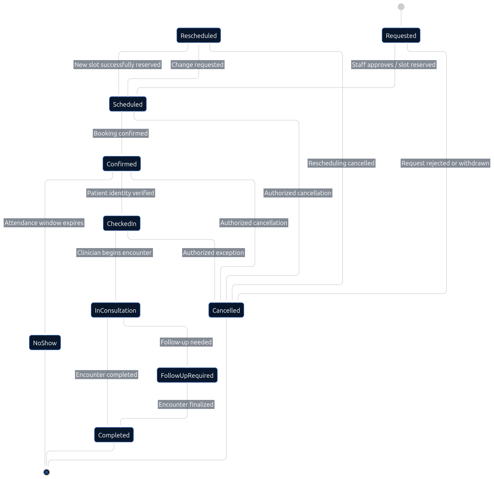

# 03 — Appointment Lifecycle

> **Document:** Internal appointment status machine — states, permitted transitions, role authority, and conditions
> **Version:** 1.0
> **Status:** Draft for review
> **Audience:** Developers and AI coding agents
> **Related documents:** `02-PATIENT-APPOINTMENT-WORKFLOW.md`, `02-PROJECT-GLOSSARY.md §13.1`, `01-ROLES-AND-PERMISSIONS.md`
> **Rule:** Only the transitions listed here are permitted. Any other change is rejected and audited as an anomaly.

---

## 1. Status Vocabulary (Canonical)

`REQUESTED` · `SCHEDULED` · `CONFIRMED` · `CHECKED_IN` · `IN_CONSULTATION` · `COMPLETED` · `CANCELLED` · `RESCHEDULED` · `NO_SHOW`

(Defined in `02-PROJECT-GLOSSARY.md §13.1` — these exact strings are used in DB, API, and UI.)

---

## 2. Lifecycle Diagram



**Diagram analysis** — The state diagram renders the canonical status machine:

- **Happy path is a straight vertical spine:** REQUESTED → SCHEDULED → CONFIRMED → CHECKED_IN → IN_CONSULTATION → COMPLETED — six states, five forward transitions, no shortcuts drawn.
- **Side exits cluster on the right:** CANCELLED is reachable from REQUESTED/SCHEDULED/CONFIRMED (T-09, plus the approved CHECKED_IN exception T-10), and NO_SHOW hangs off CONFIRMED (T-11) — drawn as terminal states with retention notes, never deletion.
- **RESCHEDULED is a round-trip, not a terminal:** SCHEDULED/CONFIRMED → RESCHEDULED → SCHEDULED (T-07/T-08) — the diagram's loop shape is the visual contract that a reschedule must land in a valid slot again, re-verified transactionally.
- **No reverse edges:** nothing points backwards (e.g., no CHECKED_IN → CONFIRMED) — enforcing the prohibited-transitions rule (`422 INVALID_TRANSITION`).

The transition table below is the implementation source of truth; the diagram is its visual twin.

```text
                 ┌───────────────┐
                 │   REQUESTED   │  (patient/staff initiated booking)
                 └───────┬───────┘
                         │ schedule (slot allocated)
                         ▼
                 ┌───────────────┐
        ┌───────>│   SCHEDULED   │<──────── RESCHEDULED re-confirms here
        │        └───────┬───────┘
        │                │ confirm (auto per policy or staff)
        │                ▼
        │        ┌───────────────┐
        │        │   CONFIRMED   │
        │        └───────┬───────┘
        │                │ check-in (identity verified)
        │                ▼
        │        ┌────────────────────┐
        │        │    CHECKED_IN      │─── approved cancellation ───┐
        │        └───────┬────────────┘                             │
        │                │ doctor calls patient                     │
        │                ▼                                          │
        │        ┌────────────────────┐                             │
        │        │  IN_CONSULTATION   │                             │
        │        └───────┬────────────┘                             │
        │                │ encounter finalized                      │
        │                ▼                                          ▼
        │        ┌───────────────┐                    ┌────────────┐
        └────────┤   COMPLETED   │                    │ CANCELLED  │
                 └───────────────┘                    └────────────┘

  CONFIRMED ── no-show past grace period ──> NO_SHOW (retained, not deleted)
  SCHEDULED ── moved by party ──> RESCHEDULED ── new slot ──> SCHEDULED
  REQUESTED ── cancelled pre-confirmation ──> CANCELLED
```

---

## 3. Transition Table (Implementation Source of Truth)

| # | From | To | Allowed by | Conditions | Side effects |
|---|------|----|-----------|------------|--------------|
| T-01 | — | `REQUESTED` | Patient (own), Receptionist, Admin | Valid slot request; patient record exists | Booking notification queued |
| T-02 | `REQUESTED` | `SCHEDULED` | Receptionist, Admin | Slot available (re-checked **in transaction**) | Confirmation queued |
| T-03 | `SCHEDULED` | `CONFIRMED` | System (auto per policy), Receptionist | Within booking horizon; policy satisfied | Reminder scheduling |
| T-04 | `CONFIRMED` | `CHECKED_IN` | Receptionist | Identity verified on arrival | Queue token issued; audit |
| T-05 | `CHECKED_IN` | `IN_CONSULTATION` | Doctor (own schedule) | Encounter created (FR-21) | Queue position released |
| T-06 | `IN_CONSULTATION` | `COMPLETED` | Doctor (own schedule) | Encounter finalized | Billing charges finalized; audit |
| T-07 | `SCHEDULED`/`CONFIRMED` | `RESCHEDULED` | Receptionist, Admin, Patient (own, within policy) | New slot re-verified in transaction; within cancellation window or authorized override | Notifications; audit of both moves |
| T-08 | `RESCHEDULED` | `SCHEDULED` | System | New slot committed | Notification |
| T-09 | `REQUESTED`/`SCHEDULED`/`CONFIRMED` | `CANCELLED` | Receptionist, Admin; Patient (own, within policy window) | Policy window or authorized override; reason recorded | Notifications; slot freed; waitlist trigger |
| T-10 | `CHECKED_IN` | `CANCELLED` | Authorized staff only | Approved exception, reason mandatory | Audit + oversight visibility |
| T-11 | `CONFIRMED` | `NO_SHOW` | Receptionist, Doctor | Past grace period per policy | Appointment retained; audit; policy actions (e.g., flag) |
| T-12 | any active | terminal | — | Only via listed transitions | — |

**Prohibited:** direct jumps (e.g., `REQUESTED → CHECKED_IN`), deletion of appointments, silent status edits outside this table. Violations are rejected with `422 INVALID_TRANSITION` and audited.

---

## 4. Concurrency & Idempotency

- Slot allocation (T-02, T-07) must re-verify availability **inside the same transaction** as the status write (AC-15).
- Booking retries with the same idempotency key return the original appointment — never a duplicate (AC-16).
- Race losers receive `409 SLOT_TAKEN` plus alternative slot suggestions.

---

## 5. Role Authority Summary

| Role | May execute |
|------|-------------|
| Patient | T-01 (own), cancel/reschedule own within policy |
| Receptionist | T-01, T-02, T-03, T-04, T-07, T-09, T-11 |
| Doctor | T-05, T-06 (own schedule), T-11 |
| Admin | All, with audit |
| Nurse | Read-only (assigned view) |

---

## 6. Audit Requirement

Every transition writes: actor, role, appointment ID, from-status, to-status, timestamp, and reason (mandatory for T-09, T-10). Acceptance criteria: AC-14 → AC-21.

---

*End of document — Appointment Lifecycle v1.0*
