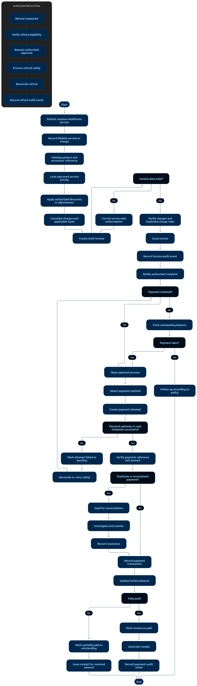

# 04 — Billing Workflow

> **Document:** Invoice generation, payments, refunds, adjustments, and reconciliation
> **Version:** 1.0
> **Status:** Draft for review
> **Audience:** All audiences
> **Related documents:** `01-FUNCTIONAL-REQUIREMENTS.md §9`, `01-ROLES-AND-PERMISSIONS.md §4.6`, `02-PROJECT-GLOSSARY.md §13.2`
> **Rule:** Money records are finalized, idempotent, and reconciled. A client-side "payment successful" message is never proof of payment.

---

## 1. Invoice Lifecycle



**Diagram analysis** — The tall billing flowchart separates three concerns into distinct vertical tracks that merge at reconciliation:

- **Invoice track (left spine):** charges from services/lab/pharmacy feed a DRAFT invoice → review → ISSUE → payment states (PARTIALLY_PAID → PAID) with REFUNDED/CANCELLED as authorized side-exits — matching the canonical statuses in Glossary §13.2 and the immutability rule after issue (AC-44).
- **Payment track:** every payment path passes an idempotency-key gate before the transaction node — the diagram places the gateway/trusted-confirmation decision before any balance update, visualizing FR-41/AC-47 (client claims are never proof).
- **Authorization gates:** refund and discount nodes are drawn behind explicit approver decision points (PERM-54/55) with reason capture — unauthorized attempts terminate at a rejection node that also writes audit (AC-48).
- **Reconciliation node at the bottom** collects gateway settlements, cash, and invoices into a matching pass with a discrepancy branch — matching §4 and AC-49.
- No edge anywhere allows silent editing of an ISSUED invoice — corrections are drawn as credit-note/amendment side paths only.

```text
Encounter services + lab orders + dispensed medicines
  │
  ▼
DRAFT invoice created (Accountant) — itemized, linked to patient + encounter
  │  ├─ editable freely while DRAFT
  ▼
Review → ISSUE (Accountant)
  │
  ▼
ISSUED — visible to patient; silent edits blocked
  │
  ▼
Payments received ──────────────┐
  │                             │
  ├─ full → PAID                ├─ partial → PARTIALLY_PAID (balance tracked)
  │                             │
  ▼                             ▼
Finalized financial record     Further payments until PAID
  │
  ├─ refund (authorized) → REFUNDED (full or partial, audited)
  ├─ cancellation (authorized) → CANCELLED (credit adjustment recorded)
  └─ correction → audited amendment/credit note — never silent edit
```

Canonical statuses (`02-PROJECT-GLOSSARY.md §13.2`):
`DRAFT` · `ISSUED` · `PARTIALLY_PAID` · `PAID` · `REFUNDED` · `CANCELLED`

---

## 2. Payment Flow

```text
Patient/Reception/Accountant initiates payment on an ISSUED/PARTIALLY_PAID invoice
  │
  ▼
Payment request created with IDEMPOTENCY KEY
  │
  ├─ Online: gateway checkout → webhook/response from GATEWAY (trusted)
  │             └─ verify signature + amount + currency server-side
  ├─ Cash/POS: recorded by authorized staff; receipt issued
  │
  ▼
TRANSACTION: record payment → update invoice balance → status transition
  │   (duplicate key → return original result, no second record — AC-45)
  ▼
Receipt/notification to patient → audit entry
```

**Hard rules**
- Payment success is established **only** by trusted gateway confirmation or verified manual recording with actor identity (FR-41, AC-47).
- Partial payments keep an exact outstanding balance (AC-46).
- Duplicate submissions with the same idempotency key are rejected/returned as the original (AC-45).

---

## 3. Refunds & Discounts

| Operation | Authorization | Record |
|-----------|---------------|--------|
| Refund (full/partial) | `PERM-54` (Accountant, Admin) | Amount, reason, approver, original payment link, audit |
| Discount | Policy-defined approver | Percentage/amount, reason, approver, audit |
| Invoice correction | `PERM-55` | Credit note/adjustment line linked to invoice; original preserved |

Unauthorized attempts are rejected and audited (AC-48).

---

## 4. Reconciliation

```text
Periodic reconciliation run (Accountant)
  │
  ├─ Gateway settlements  ↔ recorded online payments
  ├─ Cash drawer totals   ↔ recorded cash payments
  └─ Bank deposits        ↔ total collections
  │
  ▼
Discrepancy report (missing, extra, mismatched amounts)
  │
  ▼
Investigation → adjustment with authorization → audit
```

Reconciliation output is retained as a financial record (FR-44, AC-49).

---

## 5. Prohibited Practices

1. Editing an `ISSUED`/`PAID` invoice silently — corrections are credit notes/amendments only.
2. Treating frontend success messages as payment proof.
3. Processing payments without idempotency keys.
4. Refunds/discounts without recorded approver and reason.
5. Deleting or voiding payment records — only audited reversing entries.
6. Exposing one patient's financial data to another (object-level checks always apply).

---

## 6. Audit Requirements

Every invoice issue, payment, refund, discount, adjustment, and reconciliation action records actor, role, resource ID, amounts, timestamp, and outcome. Financial audit events are visible to Accountant (`PERM-65`) and Admin.

---

*End of document — Billing Workflow v1.0*
