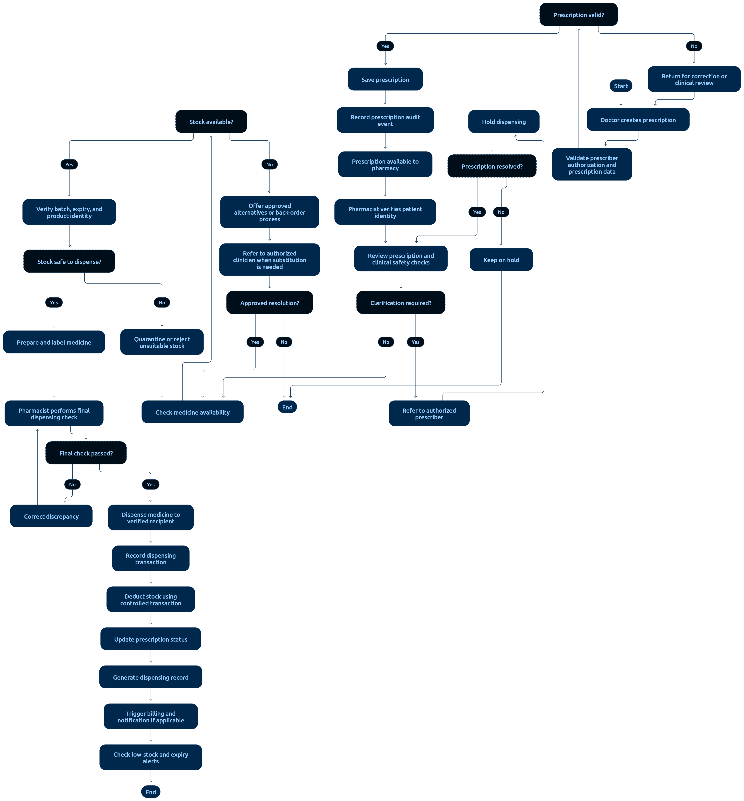
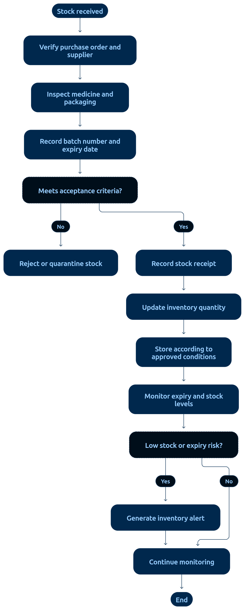

# 05 — Pharmacy Workflow

> **Document:** Prescription validation, dispensing, medicine inventory, and stock control
> **Version:** 1.0
> **Status:** Draft for review
> **Audience:** All audiences
> **Related documents:** `01-FUNCTIONAL-REQUIREMENTS.md §8`, `06-LABORATORY-WORKFLOW.md` (same discipline applies), `02-PROJECT-GLOSSARY.md §13.4`
> **Rule:** Only valid prescriptions from authorized prescribers are dispensed; the application never prescribes or changes treatment.

---

## 1. Dispensing Flow



**Diagram analysis** — The pharmacy flowchart is structured as a validation gauntlet before any stock moves:

- **Prescription intake is gated, not streamed:** the diagram shows the prescription arriving from the clinical module into a validation queue, with six parallel validity checks (authorization, patient match, status, dose completeness, duplicate dispensing, stock) — all drawn as a decision cluster that must pass together (FR-33/AC-35).
- **The prescriber-return branch is prominent:** clinical uncertainty routes back to the prescriber with a note, never to a local override — the visual enforcement of "the application never prescribes" (X-05).
- **FEFO decision node:** batch selection is drawn as choosing the earliest-expiry valid batch, with expired and quarantined branches terminating at block nodes (AC-37/AC-40).
- **Single transaction node for the dispense commit:** stock deduction, dispense record, prescription status update, and billing charge are drawn as one atomic group — matching the mandatory transaction scope in `04-SYSTEM-DESIGN/02-DATABASE-DESIGN.md §6`.
- Audit and receipt nodes close every successful path; every blocked path also terminates in an audit write.

The inventory sub-flow diagram below is referenced in §3:



**Sub-flow analysis** — Receipt → available stock → four sanctioned movement types (dispense FEFO, quarantine, recall, authorized adjustment) with an expiry sweep auto-quarantining expired batches. The diagram's core invariant is drawn structurally: every movement passes through the stock-movement record node, and there is no path that decrements stock without a batch reference — the negative-stock and batch-mandatory rules (FR-35) as shapes.

```text
Prescription created by Doctor (ACTIVE) → appears in Pharmacy validation queue
  │
  ▼
Pharmacist VALIDATES
  ├── pharmacist authorized? (PERM-41/42)
  ├── patient identity matches prescription?
  ├── prescription status ACTIVE / PARTIALLY_DISPENSED (not CANCELLED/EXPIRED)?
  ├── dose/frequency/duration fields complete and plausible (system's defined scope)?
  ├── duplicate dispensing check (already fully dispensed?)
  └── stock availability for required medicine + batch?
  │   └─ clinical uncertainty → RETURN TO PRESCRIBER (never alter therapy)
  ▼
Select batches (FEFO: first-expiry, first-out; expired batches blocked — AC-37)
  │
  ▼
TRANSACTION: deduct stock per batch (never below zero — AC-38)
  │           → record dispense (medicine, batch, qty, dispenser, timestamp)
  │           → update prescription status (PARTIALLY_DISPENSED/FULLY_DISPENSED)
  │           → create billing charge (patient + encounter)
  ▼
Receipt/label + audit entry → END
```

---

## 2. Prescription Status Handling

Canonical statuses (`02-PROJECT-GLOSSARY.md §13.4`):
`ACTIVE` · `PARTIALLY_DISPENSED` · `FULLY_DISPENSED` · `CANCELLED` · `EXPIRED`

| Situation | Behavior |
|-----------|----------|
| Doctor cancels prescription | Status → `CANCELLED`; pharmacy queue removes it; audit |
| Beyond validity window | Status → `EXPIRED`; not dispensable |
| Partial dispense | Remaining quantities stay `PARTIALLY_DISPENSED`; later dispenses allowed |
| Prescriber unreachable/uncertain | Do **not** dispense; return to prescriber with note |

---

## 3. Inventory Sub-Flow

```text
Stock received (purchase/delivery)
  → record medicine, batch number, expiry, quantity
      │
      ▼
Available stock (by batch) ── dispense (FEFO) ──> deduction
      │
      ├─ quarantine (suspect quality/recall) → blocked from dispensing
      ├─ recall (batch) → all remaining stock quarantined + flagged
      ├─ stock adjustment (authorized, reason mandatory) → audited delta
      └─ expiry sweep → expired batches auto-quarantined
```

**Inventory rules**
- Stock movements are transactional; negative stock is impossible (FR-35, AC-38).
- Batch and expiry are mandatory on receipt; dispense without batch is rejected.
- Quarantine/recall blocks dispensing and is fully audited (AC-40).
- Stock adjustments require authorization (`PERM-44`) with reason; large adjustments may require Admin approval per policy (AC-41).

---

## 4. Safety & Segregation Rules

1. The application **never prescribes** or alters therapy — clinical decisions belong to prescribers (X-05).
2. Pharmacists validate within the system's defined scope; uncertainties go back to the prescriber.
3. Pharmacy, clinical, and financial permissions remain separate (SoD, C-05): pharmacists cannot edit prescriptions; doctors cannot edit stock.
4. Dispensing records are preserved; corrections are audited entries, never deletions.
5. Controlled-substance handling (if applicable per facility policy) may add countersign rules — configured, not hard-coded.

---

## 5. Audit Requirements

Validation, dispensing, stock movements, adjustments, quarantine, and recall all record actor, role, resource, quantities, batch IDs, timestamps, and outcomes. Criteria: AC-35 → AC-42.

---

*End of document — Pharmacy Workflow v1.0*
