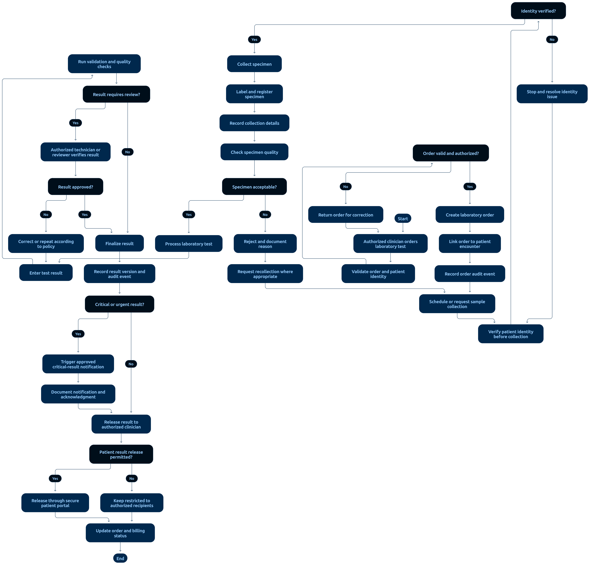

# 06 — Laboratory Workflow

> **Document:** Lab orders, specimen collection, processing, verification, release, and amendments
> **Version:** 1.0
> **Status:** Draft for review
> **Audience:** All audiences
> **Related documents:** `01-FUNCTIONAL-REQUIREMENTS.md §7`, `02-PROJECT-GLOSSARY.md §13.3`, `05-SECURITY-AND-PRIVACY/04-EMERGENCY-BREAK-GLASS-ACCESS.md`
> **Rule:** No result reaches a patient or clinician's released view without verification; originals are never destroyed.

---

## 1. Complete Lab Flow



**Diagram analysis** — The lab flowchart draws the order-to-release pipeline as a status ladder with verification as the central gate:

- **Identity verification precedes specimen collection:** the first decision node is patient identity (AC-29 precondition), before any specimen node — matching §1's precondition.
- **Specimen tracking is drawn as a record cluster:** collection time, collector, type, specimen ID, and chain-of-custody entries appear as one record group — one write, one audit event.
- **The RESULT_ENTERED → VERIFIED gate is the diagram's widest decision:** entry and verification are drawn as separate actor nodes (separable duties, §2), and every patient-visibility edge leaves **only** from VERIFIED/RELEASED — the unverified-invisible rule (FR-25/AC-30) as structure.
- **Critical-result branch:** a diamond on verified results routes to the clinician-alert node with an explicit acknowledgment record before release continues (AC-32).
- **Amendment loop:** the amendment path draws a new version node with the original preserved (a parallel retained copy), never an overwrite — AC-33 as shape.
- Status labels on nodes use the canonical values from Glossary §13.3 in exact order.

```text
Doctor orders test(s) → Lab Order linked to patient + encounter (ORDERED)
  │                        └─ billing charge created (AC-34)
  ▼
Lab queue: order appears for lab staff
  │
  ▼
SPECIMEN COLLECTION
  ├── verify patient identity (approved process — AC-29 precondition)
  ├── record: collection time, collector, specimen type, specimen ID
  └── chain-of-custody entries where required
  │      └─ status → SPECIMEN_COLLECTED
  ▼
PROCESSING (IN_PROCESS) — instrument/work performed; processing notes recorded
  │
  ▼
RESULT ENTRY (authorized personnel only — PERM-32)
  │      └─ status → RESULT_ENTERED (invisible to patient)
  ▼
VERIFICATION (authorized personnel — PERM-33)
  │   ├── reviewer checks values, units, patient matching
  │   └── status → VERIFIED
  │
  ├── critical value? → CRITICAL ALERT to responsible clinician
  │        └── acknowledgment recorded (who, when) — AC-32
  ▼
RELEASE (PERM-34)
  ├── visible to ordering doctor (scope-checked)
  ├── visible to patient per policy (released data only — FR-25)
  └── status → RELEASED
  │
  ▼
AMENDMENT (if error found later)
  ├── original result preserved; new version created
  ├── reason + author recorded; status → AMENDED
  └── released version updated; re-verification required
```

Canonical statuses (`02-PROJECT-GLOSSARY.md §13.3`):
`ORDERED` · `SPECIMEN_COLLECTED` · `IN_PROCESS` · `RESULT_ENTERED` · `VERIFIED` · `RELEASED` · `AMENDED` · `CANCELLED`

---

## 2. Verification Rules

- Result entry and verification are **separable duties**: where staffing allows, a different qualified person verifies (policy-configurable for small facilities).
- Verification requires confirming patient match, specimen match, units, and plausibility flags.
- Verification cannot be performed on cancelled orders or collected-but-mismatched specimens.

---

## 3. Critical Results

| Step | Requirement |
|------|-------------|
| Detection | System flags results matching facility-defined critical ranges (configurable) |
| Notification | Responsible clinician alerted via approved channel (in-app + escalation per policy) |
| Acknowledgment | Recorded: who acknowledged, when (AC-32) |
| Escalation | Unacknowledged criticals escalate per policy after timeout |
| Audit | Detection, notification, acknowledgment, escalation all logged |

---

## 4. Release & Visibility Rules

1. **Unverified results are never visible to patients** (FR-25, AC-27, AC-30).
2. Released results appear in the patient portal and to the ordering doctor (scope-checked).
3. Reports/attachments (PDF/images) are access-controlled like the data itself; direct URLs must not bypass authorization.
4. Release is per-result, per-policy — the facility controls what is auto-released vs. clinician-mediated.

---

## 5. Amendments

- Corrections create a **new version**; the original is retained and retrievable (AC-33).
- Amendments require author + reason, re-verification, and audit; released results are re-released after amendment.
- Deleting results is prohibited.

---

## 6. Audit Requirements

Order creation, specimen events, entry, verification, critical notifications/acknowledgments, release, and amendments all record actor, role, resource IDs, timestamps, and outcomes. Criteria: AC-28 → AC-34.

---

*End of document — Laboratory Workflow v1.0*
