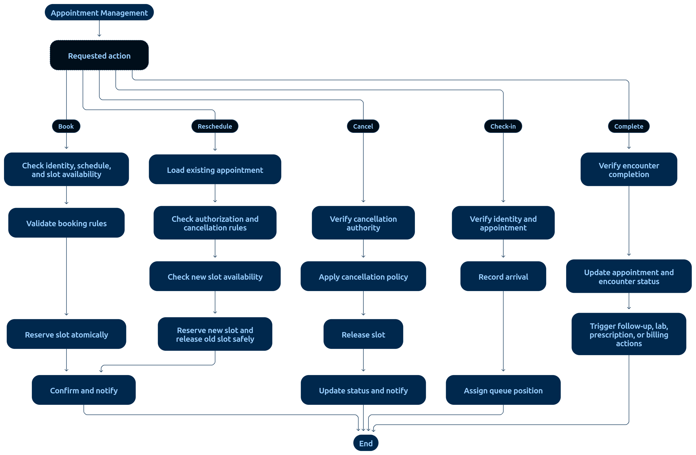

# 07 — Clinical Consultation Workflow

> **Document:** Doctor's consultation flow: encounter creation, EMR authoring, finalization, prescriptions, lab orders
> **Version:** 1.0
> **Status:** Draft for review
> **Audience:** All audiences
> **Related documents:** `02-PATIENT-APPOINTMENT-WORKFLOW.md`, `05-PHARMACY-WORKFLOW.md`, `06-LABORATORY-WORKFLOW.md`, `01-FUNCTIONAL-REQUIREMENTS.md §6`
> **Rule:** Clinical records are finalized, versioned, and amended — never silently edited.

---

## 1. Consultation Flow



**Diagram analysis** — This companion diagram (from the original specification's §7.2 "Appointment management process") zooms into the operational half of the consultation journey — the coordination around the encounter rather than the booking itself:

- **Queue-to-encounter hand-off is the focal exchange:** the checked-in patient moves through the ordered queue to the doctor's call action, which triggers encounter creation — the only door into clinical documentation (FR-21/AC-22).
- **Staff-side actions are grouped by role:** reception actions (verify, check-in, token) and doctor actions (call, document, finalize) are visually separated lanes — matching the role authority table in `03-APPOINTMENT-LIFECYCLE.md §5`.
- **Completion is drawn as a fan-out:** finalizing the encounter fans out to lab (if ordered), pharmacy (if prescribed), and billing — the same three-way fan that `08-CROSS-MODULE-INTEGRATION-FLOW.md` coordinates.
- **No-show and cancellation branches** terminate in retained-record states with audit annotations — nothing in the diagram deletes an appointment.

Use this diagram for implementing the check-in → queue → consultation UX screens (`07-USER-EXPERIENCE/01-PAGE-AND-NAVIGATION-STRUCTURE.md` §3.2–3.3).

```text
Appointment CHECKED_IN (patient in queue)
  │
  ▼
Doctor calls patient → encounter created (linked to appointment + patient)
  │     appointment status → IN_CONSULTATION
  ▼
Doctor reviews (scope-checked views):
  ├── patient demographics, allergies, ongoing medications
  ├── relevant history: past encounters, nursing entries, released lab results
  └── documents/attachments (access-controlled)
  ▼
Doctor records EMR:
  ├── symptoms / examination findings
  ├── diagnosis / diagnoses
  ├── clinical notes
  └── plan
  ▼
Actions from consultation (any combination, any order):
  ├── create PRESCRIPTION (medicine, dose, frequency, duration) → pharmacy queue
  ├── order LAB TESTS → lab queue (charges linked)
  └── record advice / follow-up plan (follow-up appointment via booking flow)
  ▼
FINALIZE encounter record
  │     └── appointment status → COMPLETED (T-06)
  ▼
Post-visit:
  ├── lab results flow back (06-LABORATORY-WORKFLOW.md)
  ├── pharmacy dispenses (05-PHARMACY-WORKFLOW.md)
  └── billing consolidates charges (04-BILLING-WORKFLOW.md)
```

---

## 2. EMR Finalization & Amendments

| Rule | Detail |
|------|--------|
| Draft phase | Entries are editable until finalized (within the encounter) |
| Finalization | Doctor marks the record complete; direct editing disabled thereafter |
| Amendment | Audited change with author + reason; new version created, original preserved (AC-23, AC-24) |
| Version history | Every prior version retrievable; diffs viewable in UI |
| Prohibition | No silent edits, no deletions, no overwrite of finalized content (C-04) |

---

## 3. Scope & Visibility

- The Doctor sees only patients within their assigned scope (R-01); opening another doctor's patient record directly is denied and audited.
- Nurses see relevant context for assigned patients and add nursing entries (PERM-24).
- The Patient sees only **released** items from their own record (FR-25): finalized encounter summaries per policy, released results, own prescriptions (AC-27).

---

## 4. Prescriptions from Consultation

- Prescription fields: medicine, dose, frequency, duration, notes; linked to encounter + patient.
- Immediately visible to pharmacy (validation queue) and in the patient's own records (`ACTIVE`).
- Cancellation by the prescriber is audited and notifies pharmacy (see `05-PHARMACY-WORKFLOW.md §2`).

---

## 5. Lab Orders from Consultation

- Tests are ordered against the encounter; charges are auto-linked (AC-34).
- Results return to the ordering doctor (scope-checked) and, once released, to the patient per policy.

---

## 6. Audit Requirements

Encounter creation, each EMR write, finalization, amendment, prescription creation/cancellation, and lab order creation record actor, role, patient, encounter, resource IDs, and timestamps. Criteria: AC-22 → AC-27.

---

*End of document — Clinical Consultation Workflow v1.0*
