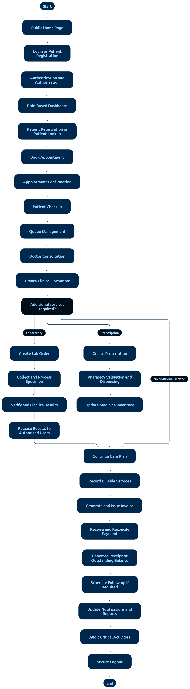

# 08 — Cross-Module Integration Flow

> **Document:** How HMS modules interact during a typical outpatient visit
> **Version:** 1.0
> **Status:** Draft for review
> **Audience:** All audiences
> **Related documents:** All workflow documents in `03-APPLICATION-FLOWS/`
> **Rule:** The sequence below is a **typical** outpatient visit, not a mandatory order — facility policies may reorder billing/lab/pharmacy steps.

---

## 1. Typical Outpatient Visit (End-to-End)



**Diagram analysis** — This tall vertical flow maps the complete healthcare service journey and is the visual master-view of the module hand-offs:

- **Module boundaries are drawn as labeled stages**, numbered roughly (1) public site → (2) authentication → (3) appointments → (4) reception/check-in → (5) queue → (6) clinical → branching to (7) laboratory and (8) pharmacy → merging at (9) billing → (10) notifications throughout → (11) reports/audit as a background layer → (12) follow-up.
- **The clinical stage is the only fan-out point:** lab and pharmacy branches originate exclusively from the consultation node — no edge lets billing or pharmacy start before a clinical source exists (enforces charge linkage, AC-34/AC-42).
- **Lab and pharmacy run as parallel rails** that re-merge before billing — the diagram's structure is why §3 rule 7 (flexible ordering) is safe: the merge node tolerates either rail completing first.
- **Notifications are drawn as a cross-cutting column**, not a sequence step — matching the outbox pattern (side effects never block the main transaction).
- **Reports/audit spans the whole height** as a background band — every stage boundary in the diagram is also an audit boundary (matrix in §2).

The hand-off matrix below is the implementation checklist for each arrow in this diagram.

```text
PATIENT JOURNEY (module hand-offs numbered)

(1) PUBLIC SITE
    Patient finds hospital, books or walks in
        │
        ▼
(2) AUTHENTICATION
    Login / self-registration → Patient dashboard
        │
        ▼
(3) APPOINTMENTS
    Booking confirmed → reminder → visit day
        │
        ▼
(4) RECEPTION
    Identity verified → CHECKED_IN → queue token
        │                        │
        │                        ▼
        │                 (5) QUEUE: doctor calls patient
        ▼
(6) CLINICAL (Doctor)
    Encounter created → EMR written
        │
        ├──(7) LABORATORY: orders → specimen → verify → release
        │         └── results return to doctor; released to patient
        │
        ├──(8) PHARMACY: prescription → validate → dispense (FEFO)
        │         └── stock deducted; batches recorded
        │
        └──(9) BILLING: services + lab + medicines → invoice
                  ├── payment (full/partial) → receipt
                  └── reconciliation later
        │
        ▼
(10) NOTIFICATIONS (throughout)
     confirmations, reminders, results-ready, bills
        │
        ▼
(11) REPORTS / AUDIT (background)
     every step authorized + logged; dashboards aggregate
        │
        ▼
(12) FOLLOW-UP
    Patient books next visit; waitlist if needed
```

---

## 2. Module Interaction Matrix

| When this happens… | These modules react |
|--------------------|---------------------|
| Appointment booked (Appointments) | Notifications (confirmation); Reports (schedule load) |
| Check-in (Reception) | Queue updated; Doctor sees patient in own list |
| Encounter created (Clinical) | Appointments → `IN_CONSULTATION`; Reports |
| Lab order placed (Clinical → Lab) | Lab queue; Billing charge created; Notifications |
| Result verified (Lab) | Doctor notified; patient release per policy; Reports |
| Critical result (Lab) | Clinician alert + acknowledgment; audit |
| Prescription created (Clinical → Pharmacy) | Pharmacy validation queue; Notifications |
| Dispense completed (Pharmacy) | Stock deducted; Billing charge created; Patient record updated |
| Invoice issued (Billing) | Patient notified; Reports (financial) |
| Payment recorded (Billing) | Receipt; Notifications; Reports; Reconciliation feed |
| Refund approved (Billing) | Reversing entries; audit; Notifications |
| Stock adjusted (Pharmacy) | Audit; Reports (inventory) |
| Break-glass used (Security) | Audit + oversight review queue |

---

## 3. Integration Rules

1. **Module boundaries:** modules interact through defined service interfaces/APIs — never by writing to another module's database collections directly (NFR-29).
2. **Charge linkage:** every billable action (lab order, dispense, service) carries patient + encounter IDs so invoices are complete (AC-34, AC-42).
3. **Statuses are canonical:** all modules use glossary status vocabularies; cross-module reactions trigger only on listed transitions.
4. **Notifications are minimum-necessary:** no module may include clinical detail in external messages (NFR-16).
5. **Failures don't corrupt:** cross-module steps use transactions within a module and compensating/outbox patterns between modules where needed; a failed notification must not roll back a dispense, for example.
6. **Audit everywhere:** every hand-off in the matrix above produces an audit event with actor and resource IDs.
7. **Flexible order:** billing, lab, and pharmacy steps may interleave per facility policy; the system must not hard-code one sequence as the only valid path.

---

## 4. AI Agent Note

When implementing, treat this document as the **integration contract checklist**: for each row of the matrix, ensure the producing module emits the event and the consuming module handles it, with the audit entry written. Missing hand-offs are defects.

---

*End of document — Cross-Module Integration Flow v1.0*
